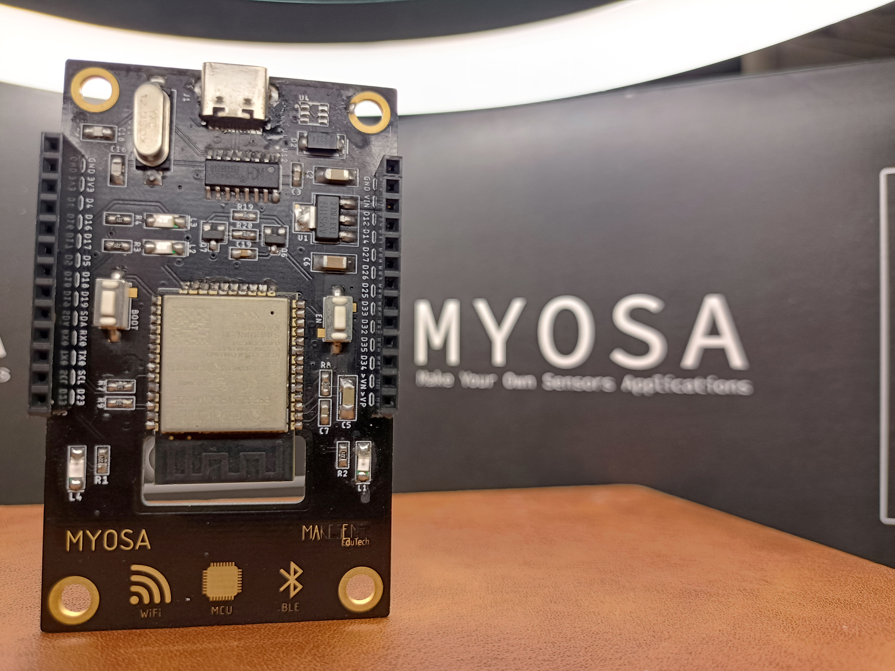

---
publishDate: 2025-12-08T00:00:00Z
title: How MYOSA Helps Beginners Learn IoT Faster
excerpt: An easy and practical look at how the MYOSA kit simplifies IoT learning for students and beginners.
image: MYOSA_Motherboard_1.jpg
tags:
  - IoT
  - MYOSA
  - Beginners
  - Sensors
---

# How MYOSA Helps Beginners Learn IoT Faster

> A beginner-friendly journey into IoT using the MYOSA development kit.

---

## Acknowledgements

Special thanks to the MYOSA team for providing an excellent learning platform and hands-on hardware kit for students and makers.

---

## Overview

The MYOSA kit is designed to make Internet of Things (IoT) learning simple, practical, and engaging for beginners. Instead of starting with complex wiring and configurations, learners can directly focus on understanding sensors, data, and real-world applications.

**Key features:**

* Beginner-friendly hardware design  
* Easy sensor integration  
* WiFi and Bluetooth connectivity  
* Perfect for student projects and prototypes  

---

## Demo / Examples

### **Images**

<p align="center">
  <br/>
  <i>MYOSA Motherboard used for IoT learning and development</i>
</p>

### **Videos**

### **Video Demonstration**

[]((https://www.youtube.com/watch?v=X0q__X7cU18))


---

## Features (Detailed)

### **1. Easy Hardware Setup**

The MYOSA kit is designed in a way that beginners can quickly understand where to connect sensors and modules without confusion. The clear board layout reduces hardware complexity.

### **2. Hands-On IoT Learning**

Students can directly work with real sensors and see live data, helping them understand how real-world IoT systems operate.

### **3. Wireless Communication**

With built-in WiFi and Bluetooth capabilities, MYOSA allows learners to explore cloud connectivity and mobile-based control easily.

---

## Usage Instructions

1. Connect the MYOSA board to your computer.
2. Upload the master code to the board.
3. Connect the required sensors.
4. Power on the board and monitor the output.

Example command format (for reference):

```plaintext
upload your_code_to_myosa
```

---

## Tech Stack

* **Embedded C / Microcontroller Programming**
* **WiFi & Bluetooth Communication**
* **IoT Sensors**
* **Web or Mobile Dashboard**

---

## Requirements / Installation

```bash
Install MYOSA USB drivers
Install required IDE
```

---

## File Structure (Optional)

```
/myosa-project
  ├─ main_code.ino
  ├─ MYOSA_Motherboard_1.jpg
  ├─ How to Upload Master Code in MYOSA Motherboard.mp4
  └─ README.md
```

---

## License

This project is for educational and learning purposes.

---

## Contribution Notes

Students and developers are welcome to improve this project by adding more sensors, dashboards, and automation use cases.
